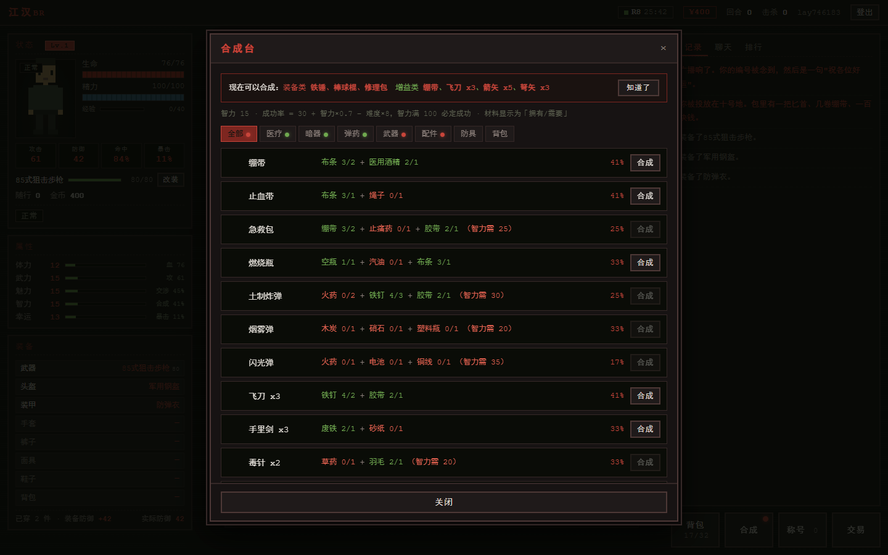
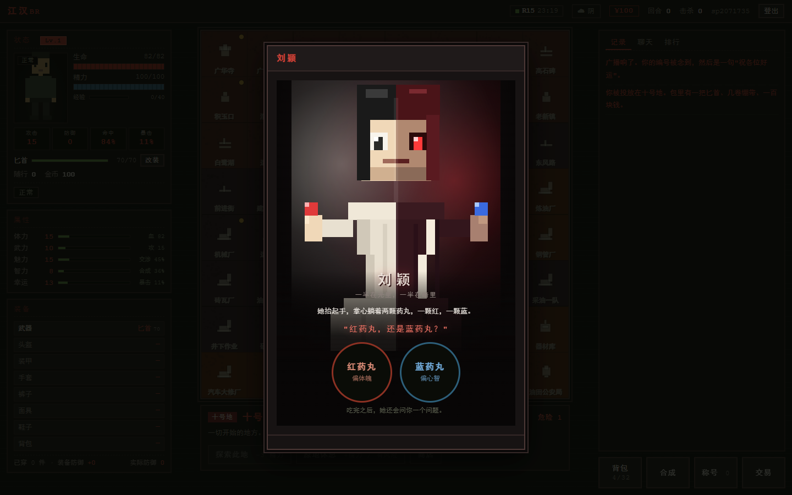

<div align="center">

# 江汉BR

**64 个区块，一个出口。**

复刻《大逃杀》设定的网页多人生存游戏。<br>
舞台搬到了江汉油田——红砖楼、采油机、碎玻璃，还有 63 个人，等着看你能不能走出去。

[](http://zzzbaba.fun:8123/)

<sub>开发中 · 随时可能重启 · 建议用电脑打开</sub>

[](#一局怎么玩)
[](#地图)
[](#背包里的每一样东西)
[](#一些数字)
[](#现在)

</div>


<p align="center"><sub>左边是你的身体，中间是 64 个区块，右边是这个世界的声音</sub></p>

---

## 这是什么

> 广播念完你的编号，然后是一句「祝各位好运」。
>
> 你被投放在十号地。包里有一把匕首、几卷绷带、一百块钱。

一场被广播出来的生存游戏。你是第 37 号，被丢进江汉油田的 64 个区块里，只有一个人能走出去。

不是动作游戏，不用练枪法。你做的每一个决定都是选择题：**往哪走、打不打、拿什么换什么**。

| | |
|:---|:---|
| ✅ **是** | 网页多人局，一局 30 分钟；回合制；会遇到真人；像素风，黑底暗红 |
| ❌ **不是** | 实时操作；3D；单机；卡通可爱风 |

---

## 进门第一眼

一页搞定：登录、看板、称号图鉴、开局倒计时、玩法说明。不用翻页，也不用自己点刷新——每 3 秒自己更新。

| | |
|:---|:---|
| **看板** | 胜 / 败 / 时间到 / 中止，四种判定直接标在轮次上。点开能看到这一轮的全部参赛者和起止时间 |
| **称号图鉴** | 53 个按分类排好，解锁的亮着，没解锁的是暗的。点开还能看是谁拿到的 |
| **倒计时** | 开局时间直接摆在页面上，不用问人。规则也在这页，新来的不用先读说明书 |

---

## 一局怎么玩

```text
00:00  ── 开局，64 个区块，全员空手，100 块
  │
  │      移动 −4 精力 / 探索 −3 精力，每次掷一次事件
  │
30:00  ── 广播员出现在广华寺钟楼
  │
45:00  ── 硬性结束，按排名结算
```

**三条路，随便挑一条：**

| 路线 | 怎么做 | 难度 |
|:---|:---|:---:|
| 🏆 撑到最后 | 活到最后，或者别人都先出局 | ★★★ |
| 🔫 拿下广播员 | 第 30 分钟后上广华寺钟楼 | ★★★★ |
| 🧒 带走七娃 | 说服那个 8 岁男孩跟你走 | ★ |

> **只有血量归零才会出局。** 精力见底不会出局，但走不动也打不了——原地休息能回一点，代价是有概率被人摸上来。

---

## 地图

8×8 共 64 个区块，区块名全部取自江汉油田真实地名。

| 片区 | 区块数 | 位置 |
|:---|:---:|:---|
| 广华 | 20 | 西北 |
| 向阳 | 20 | 中部 |
| 五七 | 20 | 东南 |
| 十号地 | 4 | 正中（出生地） |

危险度按离十号地的距离递进：出生地最安全，越往外越狠。**广华寺在地图西北角**——广播员就站在那座钟楼顶上。

---

## 遇到人了


<p align="center"><sub>左边是你，右边是那个撞见你的人。下面那行字会说清楚谁打中了谁、掉了多少血</sub></p>

回合制。你的选项是：**攻击 / 使用道具 / 换武器 / 防御 / 逃跑**。

打不过可以「放我一马」，魅力够高他真的会走。打赢了能捡他掉的东西——**这是拿到好枪的唯一途径，商人只卖基础物资**。

> **枪声会招人。** 冷兵器噪音 1~3，几乎无声；枪械 8~10，全场都听得见。拿枪打赢一场，往往意味着要连打三场，而你的血不会回。

---

## 背包里的每一样东西


<p align="center"><sub>背包按类别着色，每个格子都是一个手绘的像素图标</sub></p>

**137 件物品**：22 把武器（11 把冷兵器 + 11 把现实存在的枪械）、29 件防具、26 种药物、18 种材料、12 种弹药、5 种背包……

鼠标停在任何一件东西上，都会弹出详细数值，**并和你身上穿的做对比**——绿色 `↑` 更好，红色 `↓` 更差。新手不用查表。

---

## 把垃圾变成武器



<p align="center"><sub>每一行都告诉你：缺什么、成功率多少、材料够不够</sub></p>

**80 条配方**，全是「小 → 大」的升级路线：绷带 → 止血带 → 急救包，匕首 → 棒球棍 → 铁锤 → 砍刀 → 长矛 → 消防斧 → … → 火箭筒。

材料只有 18 种，前中后期都有用，不会捡到一辈子用不上的垃圾。

---

## 钱能买枪，也能买人

**黑市**每 8 分钟随机换个区块开张，只待 8 分钟，地图上是个红点。所有东西三倍价——但这是全图唯一能**买到**高级枪的地方。

| 枪 | 黑市价 |
|:---|---:|
| 56式半自动步枪 | 660 |
| 95式自动步枪 | 780 |
| 95式班用机枪 | 900 |
| 双管猎枪 | 1 020 |
| 88式狙击步枪 | 1 260 |
| 40 火箭筒 | 2 100 |

**佣兵头子**常年蹲在西大垸，地图上是个蓝点。花 200 / 400 / 800 雇一个，**只帮你打一场**：你攻击时他补刀，敌人打你时他先挡，扛不住才轮到你。

身上同时只能带一个，想换得先打完。

---

## 两个人

<table>
<tr>
<td width="50%" align="center"></td>
<td width="50%" align="center"></td>
</tr>
<tr>
<td align="center"><sub><b>七娃</b> · 20% 概率跟你走</sub></td>
<td align="center"><sub><b>刘颖</b> · 红药丸，还是蓝药丸</sub></td>
</tr>
</table>

### 七娃

> 一个背书包的小男孩蹲在墙根底下，手里捏着半块压缩饼干。校服袖口磨破了，鞋带松着。他抬头看你，没有害怕，也没有求救的意思。
>
> 「你叫什么？」他问。
>
> 「七娃。」他说，「我妈说让我在这儿等她，她去买东西了。」
>
> 他顿了一下：「她去了很久了。」

8 岁。跟他说话有 **20%** 概率愿意跟你走。**带走他，本轮立即结束，算你赢。**

失败他会换个地方，过一会儿还能再遇到。

### 刘颖

> 一个女人站在路中间，穿一件洗得发白的外套。她的脸一半在路灯下，一半在阴影里，看不出年纪。
>
> 她抬起手，掌心躺着两颗药丸，一颗红，一颗蓝。
>
> 「红药丸，还是蓝药丸？」

红药丸影响体魄（体力 / 武力 / 魅力），蓝药丸影响心智（魅力 / 智力 / 幸运）。随机动 **1~3 个属性**，每个 ±5~20，持续 10 分钟。

然后她会问你一道题。**答对，你拿到的多半是好事；答错，自己承担。**

---

## 一局结束的时候，会收到三行字

> 第 7 回合，你在楼道里第一次和人正面撞上，活了下来。
>
> 第 18 回合，动静太大，前后围上来两个。
>
> 最后，钟楼上那一关没过去。

不是流水账。只挑几件真正改变过局面的事：第一次动手、第一把枪、被围、最后倒在哪。

---

## 图里不只有你

后台可以投放假人，最多 50 个。它们不是站着不动的装饰——走的是和真人完全相同的逻辑：探索、遭遇、打架、捡东西、升级、出局。

血少了吃药，精力空了休息，空手会先找武器。走位按「物资 × 2 + 危险」加权，血少的时候会主动躲开高危区。

---

## 一些数字

| | |
|:---|:---|
| 地图 | 64 个区块，4 个片区 |
| 物品 | 137 件，全部手绘像素图标 |
| 合成 | 80 条配方，18 种材料 |
| 敌人 | 20 种，5 个危险等级 |
| 天气 | 6 种，每 7~10 分钟切换 |
| 状态 | 5 种：醉酒 / 清醒 / 中毒 / 冻结 / 正常 |
| NPC | 8 个常驻角色，有好感度 |
| 称号 | 53 个，分 6 类 |
| 一局 | 30 分钟，最迟 45 分钟 |

还有空投补给、玩家交易、人质、地雷、宝箱、玩家对战——这些等你进去自己撞。

---

## 现在

**体验服已经开着：<http://zzzbaba.fun:8123/>**

核心玩法跑通了，正在调平衡和补内容。随时可能重启，重启时你正在打的那局会丢。

- ✅ 单局流程、战斗、合成、装备、天气、NPC、称号、排名、黑市、佣兵
- ✅ 公网体验服（不加密，先别用你常用的密码）
- 🚧 剧情主线

**源码暂不公开。** 这个仓库只放说明和截图，代码在私有仓库里维护。

如果你玩到了，欢迎告诉我哪里不合理——数值、节奏、哪个敌人太赖，都可以。

---

<div align="center">

<sub>广播员还在钟楼上念编号。你是第 37 号。</sub>

</div>
